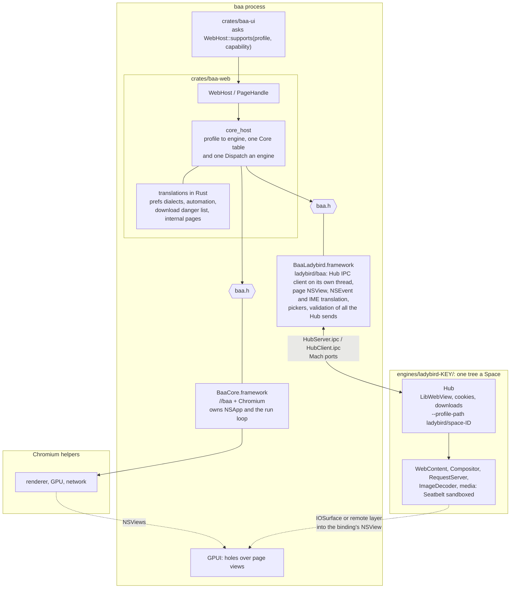

# baa — more than one engine, Ladybird first (draft, 2026-11-24)

Nothing here is built. This is the plan for a second engine behind the ADK (`chromium/baa/baa.h` and
`crates/baa-web`), for the translation layers between an engine and the Rust side, and for what
happens where an engine lacks something Chromium has. Ladybird is the first second engine.

Ladybird was read at `5f3e455eb750` (master, 2026-11-24) and from the 2026.47.7 macOS release, its
first alpha (2026-11-23). It moves fast: the process split this plan builds on landed on 2026-11-08.
Read §2 again against the pinned commit before stage 0 starts.

---

## 1. The plan on one page

1. **The seam is `baa.h`.** An engine is a library that exports the whole of `baa.h`. BaaCore is one.
   `BaaLadybird.framework` is the second: a binding that speaks Ladybird's Hub IPC and hands baa an
   `NSView` a page, as BaaCore does. `baa-web`'s `core_host` drives both through the same `Core`
   table, and the UI keeps coding against `WebHost`.
2. **An engine says what it can do.** `baa_capabilities()` returns a bit set. `WebHost::supports`
   passes it on. What an engine lacks is refused by the host and hidden by the UI. It is never
   imitated with a weaker check (§5).
3. **The engine is chosen per Space, with no restart.** Ladybird's browser process (the Hub) is a
   process of its own and its UI is an IPC client, so the binding needs neither `NSApp` nor the
   process to itself. BaaCore stays loaded as now; a Space marked Ladybird gets its own Hub. This is
   less work than swapping the whole app at a restart, and safer: incognito, mail, extensions,
   updates and Settings stay on Chromium. Restart-to-swap is §15, built from the same parts.
4. **The engine is a separate download**, built by baa's CI from a pinned Ladybird commit, signed
   with baa's identity, named by sha256 in the app (§9). Never a Ladybird the user installed.
5. **Translation happens in one of three places** (§6): in the binding when the engine has the
   feature in another shape; in `baa-web` when baa can build it from smaller engine-neutral calls or
   must add a check the engine lacks; nowhere when it is absent, and then rule 2 holds.
6. **Extensions are not translated for Ladybird**, which has none. The contract in `WebHost` is
   already neutral enough for an engine that has them (§7).

Stage 0 is a spike with kill criteria (§11). Nothing in stages 0 to 3 changes the Chromium engine or
needs an engine build.

---

## 2. What was read

### baa today

- `WebHost`/`PageHandle` in `crates/baa-web/src/lib.rs` is the contract, and `baa-ui` is generic
  over it. `MockHost` is a second implementation (tests).
- `core_host` loads `../Frameworks/BaaCore.framework` with `dlopen`, checks `baa_abi_version()` (17)
  and resolves every `baa_*` symbol by name (`ffi.rs`). Each page already holds its own
  `&'static Core`.
- Chromium owns the process: `baa_install_app` makes `NSApp` a `BaaApplication`, the first
  `-[NSApp run]` runs `ChromeMain`, PartitionAlloc takes the malloc zone at load. Sparkle comes with
  BaaCore. The app bundle is the engine's bundle with baa's binary put in (`xtask bundle`).
- A second engine already exists per tab: `core_host/webkit.rs` shows allowed streaming sites in a
  `WKWebView`. Its rule is this plan's rule: no prompts drawn for it, so everything it would ask
  is answered No, and only web schemes load.
- Chromium words that cross the contract today: pref names (`settings.rs`), DevTools protocol JSON
  (`baa_tab_cdp`, gated by `cdp.rs`), `chrome://` behind `baa://` (`skin.rs`, `baa-ui/pages.rs`),
  content-setting patterns (`site_pattern`), Chrome Web Store links (4 places in `baa-ui`).
- `crates/baa-chromium` (the harness) shares `ffi.rs` and runs 31 `tests/*.expect` scripts
  against any directory with an engine in it.
- The app is signed with the hardened runtime and without `disable-library-validation`
  (`chromium/packaging/app-entitlements.plist`): macOS loads a library into baa only if baa's team
  signed it.

### Ladybird at `5f3e455eb750`

| Fact | Where | What it means here |
|---|---|---|
| Processes: UI ↔ **Hub** ↔ Compositor, WebContent, RequestServer, ImageDecoder, MediaServer, AudioServer, VideoDecoderServer, WebRTCClient | `Documentation/ProcessArchitecture.md` | The Hub is Ladybird's browser process. |
| LibWebView lives in the Hub. A UI is a client of `Services/Hub/HubServer.ipc` (about 185 calls) and answers `HubClient.ipc` (about 155) | those files; `UI/Qt/HubConnection.cpp` is the reference client | **The binding is a Hub client.** No Ladybird code needs baa's main thread or `NSApp`. |
| The AppKit UI was removed (2026-09-29). Qt is the only UI. There is no `NSView` to reuse and no CFRunLoop event loop | `UI/` holds only `Qt` | The binding brings its own view, event translation and IME. The removed AppKit files are in git history (BSD-2). |
| Frames reach the UI as shared backing stores (`view_install_backing_stores`, `view_present_backing_store`, `Gfx::SharedImage`) or as a remote CoreAnimation layer (`view_set_remote_layer`; `CAContext`/`CALayerHost`, private API) | `HubClient.ipc`, `Services/Compositor/CoreAnimationWindowServer.mm` | Two ways to show a page with no copy. Stage 0 measures both. |
| Input: `view_enqueue_key_event`, `_mouse_event`, `_drag_event`, `_pinch_event`; IME: `view_set_marked_text_from_input_method`, `view_commit_text_from_input_method` | `HubServer.ipc` | Maps to `NSEvent` and `NSTextInputClient`. |
| One profile a Hub process (`--profile-path`, `--temporary-profile`); inside it an ordinary and a private session | `Libraries/LibWebView/Application.cpp` | **One Hub a Space.** |
| Helpers are found beside the executable; Seatbelt sandbox for every helper, not for the Hub; site isolation on; hardened runtime | `Services/*/SandboxMacOS.cpp`, `Libraries/LibWebView/Settings.h` | The engine ships as a bundle with Ladybird's layout. |
| No embedding API, and none planned (issue 4341). Public pull requests are closed since 2026-06. No version in the IPC | — | Pin a commit, build it, carry few patches, ship Hub and binding from one build. |
| `run_javascript` exists in the Hub but not in `HubServer.ipc` | `Libraries/LibWebView/ViewImplementation.h` | `eval` needs a patch (§8). |
| "The browser process and the other helper processes don't yet treat every request from the WebContent process as untrusted." README: "pre-alpha … only suitable for use by developers" | `SECURITY.md`, `README.md` | §10, §13. |
| Builds from scratch in about 29 min on a 12-core macOS runner (CMake, vcpkg, ninja, Rust 1.98, Xcode 26). Release dmg 72 MB with Qt. BSD-2; LGPL parts (FFmpeg) linked dynamically | its CI; `Meta/CMake/lgpl-libraries.txt` | Cheap next to Chromium. Fits GPL-3.0-only. |
| Prior art: `elarisbrowser/elaris`, a Rust and GPUI browser on Ladybird through a C++ bridge with a C ABI, GPL-3; it copies frames out as RGBA | reported by the research, not read | Read its bridge before stage 0. |

What Ladybird has and lacks, against what baa uses (the matrix that §6 turns into capabilities):

| Has | Partly | Lacks |
|---|---|---|
| navigation, session history, new views (`view_open_new_view`), JS dialogs, beforeunload, external-URL confirmation with the initiator's origin, permission prompts with the top-level origin, downloads with quarantine, pause and resume, context menus, find, zoom, favicons, link hover, fullscreen, mute and audio indicator, crash reports to the UI, private session, site permissions, content blocker (adblock crate, EasyList, off by default), PDF (pdf.js), WebGL, WASM, a JS JIT | permissions (geolocation, microphone, notifications only), service workers, IndexedDB (not kept on disk), getUserMedia (audio), proxy (environment only), screenshots (to a file) | extensions, HTTP auth prompt (the request is aborted), camera, WebAuthn, autofill, EME, DevTools protocol (its DevTools are Firefox's protocol on a TCP port), print from the UI, DNS over HTTPS (it has DoT), a dangerous-file check on downloads, a "proceed anyway" on certificate errors (good), script evaluation over the IPC, NSAccessibility outside Qt |

The UI must also draw things Chromium draws itself: the file picker, `<select>` lists, colour and
date pickers, tooltips, the cursor.

---

## 3. Decisions

| Decision | Choice | Rejected | Why |
|---|---|---|---|
| Where engines meet baa | `baa.h`: every engine exports all of it | A second `WebHost` implementation in Rust | Ladybird needs native glue whatever the seam (a view, events, IPC). With `baa.h` as its outside, `core_host` (about 5,500 lines: pages, the hole, mouse forwarding, dispatch) and the harness serve both engines. A second `WebHost` would copy them and compile the UI twice. |
| How the binding reaches Ladybird | A client of the Hub's IPC, Hub in its own process | LibWebView in baa's process (`Hub::ApplicationHost`) | It is the boundary Ladybird itself keeps for UIs. A Hub crash is not a baa crash. A Hub is a profile, so a Space is a Hub. |
| Granularity | Engine per Space; both engines live at once | Whole app on one engine, swapped at restart | See §1.3. Storage belongs to a profile and a profile to an engine, so the Space is the natural unit. |
| What a missing feature does | Refused in `baa-web`, hidden in `baa-ui`, per capability bit | Stubs that pretend; per-symbol `Option`s | One rule, one place to test it. CLAUDE.md: keep Chrome's check or be stricter. |
| Capability plumbing | `baa_capabilities()` looked up with `dlsym`; absent means BaaCore with every bit | ABI 18 now | No Chromium build for stages 0 to 3. `// ponytail:` it becomes a normal symbol at the next ABI bump. |
| Engine words in the ABI (pref names, CDP) | Stay as dialects: `baa-web` has one pure translation per engine | Typed neutral calls in `baa.h` now | Neutral calls mean rewriting `//baa` for no gain until a third engine shows what is common. |
| Source of Ladybird | Pinned commit of a weekly `release/` branch, built in baa's CI, patches in `ladybird/patches` | Ladybird's notarized app; a fork | No IPC version, so Hub and binding must come from one build. CLAUDE.md: artifacts are trusted by who produced them. |
| Shipping | A download into `engines/`, pinned by sha256 in the app | Inside `baa.app` | The release chain and the app's size stay as they are; the engine is optional. |
| Extensions on Ladybird | None | A WebExtension runtime of baa's own | §7. |

---

## 4. Architecture



On disk: `<data>/chromium/space-<id>` as now, `<data>/ladybird/space-<id>` for a Ladybird Space, and
`<data>/engines/ladybird-<key>/` for the engine. A Space that changes engine keeps both directories,
so going back finds its sign-ins. Nothing is copied between them.

---

## 5. A neutral ADK: capabilities and the refusal rule

`baa.h` gains one function, `uint64_t baa_capabilities(void)`, and `ffi.rs` one field. `WebHost`
gains `fn supports(&self, profile: ProfileId, capability: Capability) -> bool` and a way to say
which engine a profile is on (`baa_model::Space` gets `engine`, default Chromium).

The bits, grouped by what the UI shows or hides. BaaCore has all of them.

| Capability | Without it |
|---|---|
| `Extensions` | no toolbar, no Extensions settings for that Space, no Web Store links, no "password manager" suggestion |
| `Private` | the profile cannot be ephemeral: no incognito Space on this engine |
| `Documents` | `create_document` refuses: no mail in that Space |
| `Auth` | nothing to draw (the engine fails the request) |
| `Permissions(kinds)` | a kind the engine cannot ask is denied and not listed in the site panel |
| `DangerCheck` | `baa-web` applies its own dangerous-type list to every download (§6) |
| `Eval`, `Automation` | no reader mode, PiP script, translate, or Claude tools on that Space's tabs |
| `DevTools`, `Console`, `Emulation` | Inspect, the dock and the phone view are hidden |
| `Print`, `Find`, `Fullscreen`, `Media`, `Swipe` | the command, key and menu row are hidden |
| `Autocomplete` | the command bar shows baa.db history only |
| `SiteRules`, `ClearData(what)` | those Settings rows say "Chromium Spaces only" |
| `Accounts` | shared sign-ins skip the Space |
| `CodeField` | no verification-code offer |
| `InternalPages` | `baa://flags` and the like show a notice; `baa://settings`, history and downloads are baa's own and work |

Rules. Each has a test.

1. **Refused below, hidden above.** The host refuses a call the engine has no bit for (returns
   `None`, `false`, or drops the callback with an error), so a missed check in the UI opens nothing.
   The UI hides the control so the user does not meet a dead one.
2. **A bit is earned.** Each `tests/*.expect` names the bits it needs. The harness skips a test whose
   bits the engine does not claim, and fails the run if a claimed bit's test fails. One more test
   calls every function behind an unclaimed bit and expects the failure value.
3. **A missing check is replaced or the feature is off.** Never "the engine does not check, so baa
   does not either".
4. **Private mode means the same on every engine.** v1: an ephemeral Space is always Chromium.
   Ladybird gets `Private` only after a test shows its profile directory holds nothing of the
   session after it ends, and after a crash.
5. **A setting that an engine cannot honour says so.** `baa-web` knows, per engine, which settings
   it translates. Settings shows "Chromium Spaces only" on the others. Turning a Space to Ladybird
   lists the privacy settings that will not hold there (HTTPS-first, secure DNS, cookie policy)
   before it happens.
6. **Engines do not share data.** No cookie or login import between engines.

---

## 6. Translation layers

Where each difference is translated. "Binding" is `ladybird/baa` (C++), "Rust" is `baa-web`.

| Feature | Chromium | Ladybird | Translated in |
|---|---|---|---|
| Profile | a Chrome profile under one user data dir | a Hub process per `--profile-path`; started with the Space's first page, stopped with its last | Binding: `baa_profile_open` starts a Hub, `baa_profile_close` ends its tree |
| Page view | Chromium's `NSView` | none | Binding: an `NSView` whose layer shows the backing store's IOSurface (or hosts the remote layer) |
| Mouse, keys, scroll, pinch | native | `view_enqueue_*` | Binding: from the `NSEvent`s `core_host` already forwards. `key` callback: before the page in `keyDown:`, after it on the Hub's "not handled" |
| IME | native | marked and committed text calls | Binding: `NSTextInputClient` |
| State | `tab_state` | `view_load_start`, title, URL, favicon bitmap, `view_session_history_changed`, top-level commit | Binding keeps a mirror a view and reports changes; favicon bitmap to PNG |
| New window from a page | `tab_created`, adopted | `view_open_new_view` hands over a live view | Binding: `tab_created` with that view. The URL is never loaded again by baa (invariant) |
| Dialogs | `dialog` with Chrome's origin | alert, confirm, prompt carry no origin; beforeunload; external URL carries the initiator's | Binding: the origin is the view's last committed top-level origin from the Hub. A frame's dialog is shown under the page's origin: weaker than Chrome's "an embedded page says". Patch candidate (§8); until then the prompt names the page only |
| Permissions | all kinds | geolocation, microphone, notifications, with `top_level_origin` | Binding maps the three; Rust denies the rest |
| Downloads | Chrome's, with danger types | Hub's, with quarantine, no danger check | Binding reports them. **Rust adds the dangerous-type list** (`baa-mail`'s `mime::dangerous`, moved to `baa-model` so both reach it) and holds the file as `Dangerous` until Keep. Insecure-download warning: Rust, from the URL schemes |
| Context menu | Chrome's items | `ContextMenuRequest` | Binding builds `BaaMenuItem`s |
| Pickers, `<select>`, tooltip, cursor | Chromium draws | the UI must | Binding, natively: `NSOpenPanel`, `NSMenu`, `NSColorPanel`, a date popover. Not in `baa.h` |
| Find, zoom, mute, fullscreen, crash | callbacks | same shapes | Binding |
| Script, and what is built on it | CDP through `cdp.rs` | not in the IPC | Patch adds `view_run_javascript` with a result. Rust: `eval_value` picks CDP or that call by capability. Clicks and keys: `view_enqueue_*`. Screenshot: later |
| Settings | Chrome pref names from `settings.rs::writes` | Hub settings calls, a few flags | Rust: a second pure `writes` for Ladybird with its own names; the binding maps names to Hub calls and returns false for one it does not know |
| Content blocking | uBlock Origin component | built-in blocker, off by default | Binding turns it on at start. One neutral setting later if wanted |
| Site rules | content-setting patterns | per-origin permissions | Not in v1 (`SiteRules` off); asked each time |
| Address suggestions | Chrome's omnibox | — | Rust: none; `baa-ui` already has baa.db history |
| `baa://` pages | Chrome WebUI, skinned | `about:` pages of its own | `baa-ui/pages.rs`: baa's own routes work; the rest show a notice |
| DevTools | front-end as a page, docked | Firefox protocol on a TCP port | Not translated. A local port anyone on the machine can reach is not opened |
| Registrable domain (`site_of`) | Chrome's list | LibURL's public suffix list | Binding |
| Default browser | in `//baa` | — | Asked of BaaCore whatever the Space |
| Streaming sites | WebKit tab | WebKit tab | Already engine-neutral; stays as it is |

---

## 7. Extensions

How the engines differ:

| Engine | Format and store | API | For an embedder |
|---|---|---|---|
| Chromium | CRX, Chrome Web Store, MV3 (MV2 for the built-in uBlock) | `chrome.*`, service-worker background | real profiles and tabs; `//baa` reports toolbar state and baa draws it |
| Firefox | XPI, AMO, MV2 and MV3 | `browser.*` promises, event pages | no embedding on macOS |
| WebKit | Safari app extensions, or a folder | `browser.*`, a subset | `WKWebExtensionController` (macOS 15.4): the app supplies tabs and windows through delegate protocols |
| Ladybird | none | none | not started upstream ("we want extensions eventually"); only isolated worlds exist |

The contract in `WebHost` is already the neutral one: list (`extensions`, `extension_details`),
toolbar state (`extension_actions`), a popup as a page (`create_popup`), shortcuts
(`extension_commands`), changes (`change_extension`), and events. Nothing in it is a Chrome type but
the id string and the permission sentences, which the engine writes. An engine with extensions
translates in its binding: its ids, its install flow drawn as `DialogKind::ExtensionInstall`, its
store link (one function in `baa-ui` instead of four literals), its popup as a page. WebKit could
meet this contract; that is the test of it, and not work in this plan.

For Ladybird: `Extensions` is off. A Ladybird Space has no toolbar and its tabs say why in the
site panel. The built-in content blocker stands in for uBlock.

Not planned: a WebExtension runtime inside baa (background contexts, `chrome.*` over IPC, storage,
messaging, `declarativeNetRequest`). It is a browser subsystem of its own, it would run third-party
code on an engine that says it has no security promises yet, and Ladybird will ship its own shape
later. Trigger to look again: Ladybird lands extension support, or isolated-world script injection
reaches the Hub IPC, which would make content-scripts-only a small binding feature.

---

## 8. The Ladybird binding (`ladybird/baa`)

```
ladybird/
├─ LADYBIRD_COMMIT        the pin (a commit on a release/ branch)
├─ patches/               few; each says what it is for
├─ baa/                   the binding: exports baa.h
│  ├─ hub.cc              spawn a Hub a profile, the IPC connection, its thread
│  ├─ view.mm             page NSView: layer, NSEvent to Web::*Event, NSTextInputClient
│  ├─ bridge.cc           baa_* calls to HubServer messages, HubClient messages to callbacks
│  ├─ ask.mm              pickers, select lists, tooltips, cursor
│  └─ check.cc            validation of everything a Hub sends
└─ build.sh               fetch at the pin, apply patches, build Hub + helpers + binding
```

- **Threads.** The IPC connection lives on one thread of the binding with a `Core::EventLoop`.
  `baa_*` calls post to it; callbacks are delivered on the main queue, as `baa.h` promises.
  `baa_tab_get_state` reads the mirror, so it never waits on a Hub.
- **`baa_install_app`** does not touch `NSApp`. It stores the callbacks and starts the thread.
- **The Hub is a suspect.** A WebContent that breaks out reaches the Hub (Ladybird says so), and
  the binding sits in baa's process next to Chromium's browser process. `check.cc` bounds every
  string, size, id and bitmap before use, and the handlers have a fuzz target that feeds them
  arbitrary `HubClient` messages. Stage 0 finds out whether the UI-side decode is Rust.
- **Patches expected:** building Hub and helpers without the Qt UI target, if no option exists;
  `view_run_javascript` with a result; perhaps the asking frame's origin on dialogs. With public
  pull requests closed these are carried, so each must be small and stay under about five in all.
  A check like `xtask/check-patches.sh` applies them to the pin in seconds.
- **Accessibility.** Ladybird's `NSAccessibility` elements are tied to Qt. v1 has no page
  accessibility in a Ladybird Space; the Space picker says so. Porting
  `LadybirdAccessibilityElement.mm` to the binding's view is stage 4, before the engine stops
  being called experimental.

---

## 9. Choosing, downloading and trusting the engine

- **Choosing.** The Space picker gets an Engine row, shown only once the engine is installed.
  Changing it reloads the Space's tabs from their URLs in the other engine's profile. Incognito
  Spaces do not have the row.
- **Getting it.** Settings › Developer › Engines: "Ladybird (experimental)", its size, Download.
  The app carries a manifest line: key, URL (a baa GitHub release asset), sha256, size. The fetch is
  `curl --proto =https --proto-redir =https` to that URL only.
- **Trusting it.** Before first use and at every start: sha256 of the archive at install; the
  directory is the user's, mode 0700, never under `/Users/Shared`; `codesign` verifies the bundle
  against baa's team; macOS itself refuses the framework otherwise (library validation, which must
  stay on). A dev build takes a local engine from `BAA_LADYBIRD` with the same owner check.
- **Failing.** The engine key holds the ABI and the pin, so a mismatch is impossible by name and
  checked anyway. If the framework does not load or a Hub will not start, the Space's tabs show an
  error page with "Open this Space on Chromium". Chromium is never affected.
- **First use.** A sheet with Ladybird's own words on its state and what a Ladybird Space lacks
  (§5). Not a security prompt; no Enter rule needed, but it is not skippable by a key held down.
- **CI.** `ladybird.yml` builds at the pin, runs the harness subset, and on a release signs,
  notarizes and attaches the archive. `ladybird-bump.yml` moves the pin weekly to the newest
  `release/` branch and lands only if the build and the harness are green.

---

## 10. Security rules this adds (for CLAUDE.md once approved)

- **An engine is not trusted more than a page.** All that a Hub sends is validated in the binding
  before baa uses it. Engine-supplied strings on screen go through the shared origin helper.
- **A capability an engine does not claim is refused in `baa-web`**, not only hidden.
- **A check Chrome makes and another engine does not is made by baa or the feature is off there**
  (downloads' dangerous types and insecure downloads first).
- **Ephemeral Spaces run on an engine with `Private`**, which a test earned.
- **Mail, shared accounts, verification codes and the Keychain never meet an engine without the
  capability for them.**
- **baa runs only engine binaries it built**, found under its own data directory, owner-checked and
  signature-checked. Library validation stays on.
- **No engine opens a listening port** for DevTools or automation.

The existing invariants apply unchanged to the binding: page-supplied URLs are adopted or dropped,
prompts show the engine's origin, raw `NSView` pointers are not kept across turns.

---

## 11. Stages

Each stage lands on `main` and leaves Chromium Spaces exactly as they were.

| Stage | Builds | Done when |
|---|---|---|
| **0. Spike** (`ladybird/`, harness only) | Build Hub and helpers at the pin without Qt. A binding with `install_app`, `profile_open`, `tab_create`, `tab_load_url`, `tab_get_state`, `tab_close`. One page in the harness's `spike` window under gpui, mouse and keys in. | Written answers: frame rate while scrolling on a 120 Hz display for backing stores and for the remote layer; latency of typing; memory a Hub; binding in C++ or Rust; what the private session writes; the patch list. **Stop if** neither frame path holds the display rate, or the Hub cannot be built or run apart from Qt with five patches or fewer. |
| **1. Neutral ADK** (`baa-web`, `baa-model`, `baa-ui`, harness) | `baa_capabilities`, `WebHost::supports`, `Space.engine`, a `Core` and `Dispatch` an engine, ids kept apart per engine, UI gating, the download danger list in Rust, settings dialects, `needs:` in the harness. No Ladybird needed: `MockHost` gets a capability set. | UI tests pass with a mock that claims nothing but pages; every rule of §5 has its test; BaaCore runs unchanged. |
| **2. Browsing** (`ladybird/baa`) | All of §6 marked Binding: Hub a Space, view, input, IME, state, new views, dialogs, permissions, downloads, menus, pickers, find, zoom, fullscreen, crash. `check.cc` and its fuzz target. | The harness subset for the claimed bits is green in CI on a Ladybird engine; the refusal test is green; a day of real use by the user in one Space. |
| **3. Shipping** (`.github`, `xtask`, `baa`, `baa-ui`) | `ladybird.yml`, the bump, manifest, download and verification, the Engine row, the first-use sheet, error page and fallback. | A release build downloads, verifies and runs the engine on a clean Mac; a tampered archive, a wrong owner and an unsigned helper are each refused, by test. |
| **4. Closing gaps**, by use | accessibility port; `view_run_javascript` and Claude's tools; `Private`; `Documents` (mail) once `mail-document.expect` passes on Ladybird; print; settings. | per item: its bit claimed and its test green. |

Rough size: stage 1 is mostly gating, a few hundred lines across three crates. The binding is the
bulk, a few thousand lines of C++ and Objective-C++, most of it `view.mm` and `bridge.cc`.

---

## 12. Ownership

| Path | Owner |
|---|---|
| `ladybird/` (pin, patches, binding, build script) | a new Ladybird engine orchestrator |
| `chromium/baa/baa.h` | engine orchestrator, as now. A change to it must compile in both bindings; an ABI bump moves both |
| `crates/baa-web` (capabilities, engine per profile, Rust translations) | baa-web orchestrator |
| `crates/baa-chromium` (the harness, now for any `baa.h` engine; the name stays) | engine orchestrator |
| `crates/baa-model` (`Space.engine`), `crates/baa-ui` (gating, Engine row), `crates/baa`, `.github`, `xtask` | their owners |

---

## 13. Risks, in order

1. **A compromised Ladybird reaches baa's process through the binding.** Ladybird states its
   helpers do not yet distrust WebContent. Control: `check.cc`, the fuzz target, Hub in its own
   process, nothing sensitive in a Ladybird Space (no mail, accounts, Keychain, extensions), the
   first-use sheet. Residual: the Hub runs as the user, unsandboxed, with that Space's cookies.
2. **The Hub IPC changes under the pin.** It is two weeks old and has no version. Control: binding
   and Hub from one build, so a change is a compile error in the weekly bump, not a runtime fault;
   the bump lands only when green. Cost: steady upkeep of `bridge.cc`.
3. **Frame rate.** Backing stores may not hold 120 Hz; the remote layer is private API. Control:
   stage 0 measures before anything else is written; Chromium uses the same private API.
4. **Upstream closes the door.** No embedding goal, no outside pull requests, the AppKit UI was
   dropped. Control: few patches; the pin can sit still for weeks; nothing in Chromium Spaces
   depends on any of this.
5. **Input and IME are written from scratch.** Control: the removed AppKit UI in git history as
   the model; the IME checklist of `PLAN.md` §14.5.
6. **One Hub tree a Space costs memory.** Control: measured in stage 0; a Hub lives only while its
   Space has a live page.
7. **Accessibility is missing in v1.** Control: stated in the picker; stage 4 before the label
   "experimental" goes.

---

## 14. Decisions for the user

1. **Engine per Space with both engines loaded** (planned), or the whole app on one engine with a
   restart (§15)?
2. May the binding use `CAContext`/`CALayerHost` (private API) if backing stores cannot hold the
   display rate?
3. Carrying up to about five patches on Ladybird: acceptable?
4. Is a Ladybird Space without page accessibility acceptable for a first experimental release?
5. Go for stage 0?

---

## 15. Not planned

- **Whole app on Ladybird, Chromium not loaded, swapped at a restart.** Possible from the same
  parts, and what it adds is the reason it is not first: gpui must own `NSApp` and the run loop;
  Sparkle must load without BaaCore; default-browser, `site_of` and suggestions need their own
  implementations; mail, incognito and Settings' Chromium rows go dark for the whole app; a
  start-up fallback and a crash-loop guard are needed. Build it if a Chromium-free baa becomes a
  goal.
- **A WebExtension runtime of baa's own** (§7).
- **WebKit as a full engine.** The closest third: a system framework, no download, and an
  extensions API that fits §7's contract. `webkit.rs` would grow into a binding or stay in Rust.
- **Gecko.** No embedding on macOS.
- **Moving data between engines.**

---

## Sources

- Ladybird `5f3e455eb750`: `Documentation/ProcessArchitecture.md`, `Services/Hub/HubServer.ipc`,
  `Services/Hub/HubClient.ipc`, `Libraries/LibWebView/ViewImplementation.h`,
  `Services/Compositor/CoreAnimationWindowServer.mm`, `SECURITY.md`, `README.md`.
- Ladybird issues 4341 (embedding), 7327 and 976 (extensions), pull requests 14109 (Hub split) and
  12267 (AppKit removal); read through a summarising fetch, so check the wording before quoting.
- baa: `crates/baa-web/src/lib.rs`, `core_host/*`, `chromium/baa/baa.h` (ABI 17),
  `crates/baa-chromium`, `PLAN-chromium.md`, `PLAN-adk-refactor.md`, `CLAUDE.md`.
