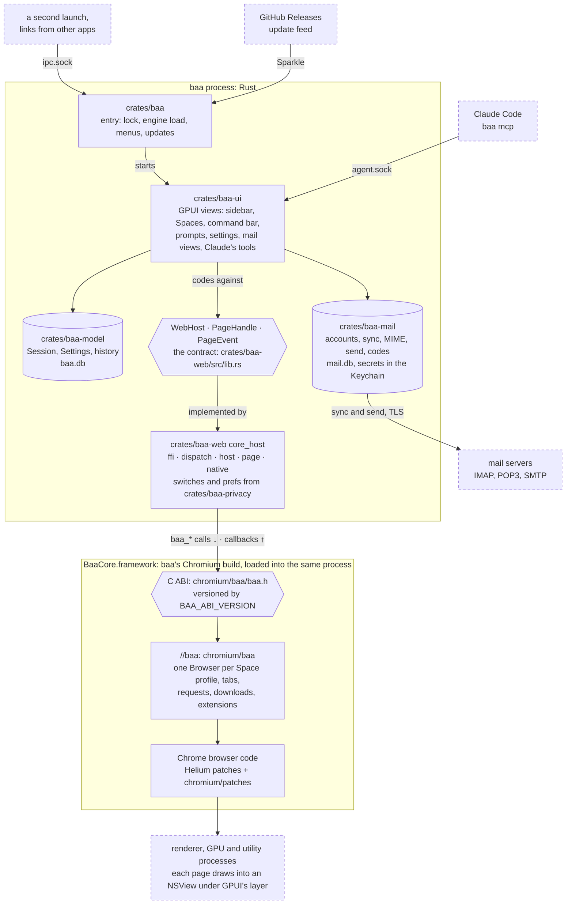
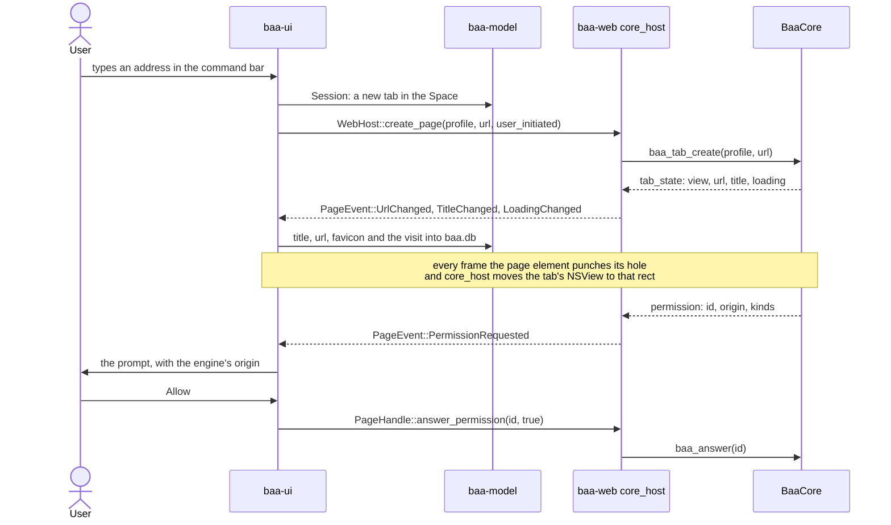

# baa

An Arc-like browser: vertical tabs, Spaces with isolated storage, a command bar, and spring-driven
motion, on baa's own Chromium build.

- Shell: Rust + [GPUI](https://github.com/zed-industries/zed/tree/main/crates/gpui) (Zed's UI framework).
- Engine: baa's own Chromium build: [Helium](https://github.com/imputnet/helium)'s patch set
  (de-Googled, GPL-3.0) plus `//baa`, a layer that lets the Rust UI drive real Chrome browsers and
  tabs (`BaaCore.framework`). Each page is a native Chromium view under GPUI's layer, so it scrolls
  and animates at the display's refresh rate, while GPUI still draws the chrome, popovers and
  command bar over it.
- Privacy: Helium patches out Google services; baa's switches cover the rest; CI checks it. No
  baa.me backend, no telemetry. The default search engine is Google, with suggestions on; both
  are in Settings › Search. `PRIVACY.md` lists everything baa contacts by itself.
- Icons: [Lucide](https://lucide.dev) (ISC), embedded from `crates/baa-ui/assets/icons`. App icon: "The leap, solid"
  from the design file, as `assets/baa.icns` (`cargo bundle` installs it) and `crates/baa-ui/assets/baa.png`.
- Extensions: Chrome Web Store extensions install per Space profile and run in every tab. uBlock
  Origin (Helium's build, vendored in `chromium/vendor`) is built in, one per Space, also in
  ephemeral Spaces. Its default filter lists are bundled and change only when that archive does; a list you add in its settings downloads from that
  list's own site. Open "Chrome Web Store" or "Extensions" from the command bar (⌘T).
- Targets: macOS (Apple silicon). Windows later, through the same `//baa`. Helium's patch
  set is frozen at `chromium/HELIUM_RELEASE`. A daily bot follows Chromium's builds inside that
  milestone by itself; a new milestone needs a Helium release taken by hand (`.github/helium-take.sh`).

`PLAN.md` is the spec (the engine is in `PLAN-chromium.md`). `CLAUDE.md` holds the rules for agents
working in this repo.

## Status

Early. Milestones 0–3 of `PLAN.md` are implemented: tabs, Spaces, per-Space storage, keymap,
command bar, de-Googling, plus Peek (links that open a tab, or shift-click, preview in a card) and
lil-baa (links from other apps open in a small window you can move into the browser), favourites
(shared by every Space) and folders. Browser basics: a Library (the archive button, or swipe right past the first Space) with
downloads kept across launches and archived tabs, a header downloads button, history
(in ⌘T, and ⌘Y), permission prompts and per-site settings, page dialogs drawn over the page,
print, view source, reader mode, Picture in Picture, translate, tab mute, Settings (⌘,), and import
of Arc's Spaces and other browsers' history. Extensions have a toolbar and popups. Settings and
Extensions are baa's own window (⌘,; `baa://settings/...` routes there), and the rest of Chrome's
pages (`baa://flags` and the like) open as tabs in baa's skin. DevTools dock beside the page. Chrome's own
prompts (HTTP auth, external-protocol links, hung or crashed pages, extension install) are drawn by
baa on the tab, page fullscreen fills the window, find shows `3/12`, tabs in a folder are a Chrome
tab group (an extension's `chrome.tabs.group` fills a folder), and the command bar ranks with
Chrome's omnibox. Extensions' keyboard shortcuts (`chrome.commands`,
rebound in Settings › Extensions), action badges and `chrome.action.openPopup` work, and a link's
address shows at the bottom of the page while the pointer is on it. Not yet: the screen-share picker.
Password managers
work through their Chrome extensions; Apple's iCloud Passwords cannot (macOS only lets Chrome and
Edge start its helper). The UI follows the pen.dev mocks. Split view shows tabs of one Space side
by side.

Mail (experimental, off by default; Settings › Mail): iCloud, Gmail, Fastmail, Yahoo and other
IMAP accounts in baa's own Mail view, an inbox sorted into Primary, Social and Promotions on the
Mac (by the headers, then Apple's on-device model), a reading pane, compose, attachments saved as
downloads, and verification codes from mail offered to a page's code field. `PLAN-mail.md` is its spec and
`PRIVACY.md` says what it connects to.

## Known limitations

- No Safe Browsing: baa shows no phishing or malware warnings, and judges downloads by file type
  only.
- Passwords, passkeys and autofill only through extensions (a password manager's Chrome
  extension). baa has no password store of its own.
- No sync between Macs.
- English only.
- No VoiceOver support in the browser's own chrome (sidebar, command bar, settings).
- Import brings in only history (from other browsers) and Arc's Spaces: no bookmarks or
  passwords.
- Apple silicon only, macOS 13 or later.
- Claude is experimental and off by default.
- Mail is experimental and off by default. Sorting the inbox into categories needs Apple
  Intelligence (macOS 26 or later); without it, bulk mail stays in Primary.

## Build

baa is a Rust app (`cargo bundle`) on top of an **engine**: a Chromium build with baa's `//baa`
layer (BaaCore.framework and Chromium's helpers). You set up an engine once, then build and run the
app as often as you like.

### Requirements

- macOS, [Homebrew](https://brew.sh).
- Rust: `rustup toolchain install stable`.
- GitHub CLI, logged in: `brew install gh && gh auth login`.
- Only to build the engine yourself (setup B): Xcode `27.2`, Python 3, and
  `brew install coreutils zstd gnu-tar rsync && pip3 install --user pillow requests`.
- Only for the engine test harness: `node`.

### First-time setup: get an engine

Pick one.

**A. Download a prebuilt engine** (about 350 MB, no Xcode). Use this for Rust-only work. It lands in
`target/engine`.

```sh
brew install zstd
# The engine's key, then the name engines had before 2026-11-22 (the tree hash of chromium/).
for T in $(.github/engine-key.sh) $(git rev-parse HEAD:chromium); do
  for RUN in $(gh api "repos/dan-hummelstad/baa/actions/artifacts?name=baa-engine-$T" -q '.artifacts[]|select(.expired|not).workflow_run.id'); do
    gh api "repos/dan-hummelstad/baa/actions/runs/$RUN" | .github/actions/engine/trusted.sh dan-hummelstad/baa && break 2
    RUN=
  done
done
[ -n "$RUN" ] || { echo "no trusted engine for this checkout; start one (below)"; exit 1; }
gh run download "$RUN" -R dan-hummelstad/baa -n "baa-engine-$T" -D target/engine
gh run download "$RUN" -R dan-hummelstad/baa -n "baa-engine-$T.sha256" -D target/engine
(cd target/engine && shasum -a 256 -c engine.tar.zst.sha256)
zstd -dc target/engine/engine.tar.zst | tar -xf - -C target/engine
```

An engine exists only for what CI has built. Its key (`.github/engine-key.sh`) covers the five
directories of `chromium/` that go into the build (`helium`, `helium-macos`, `patches`, `baa`,
`vendor`), so a change anywhere else keeps the engine. If the loop stops with "no trusted
engine", start one with `gh workflow run chromium.yml -f mode=release`, or use B. The build goes
on from the newest finished release tree of the same Chromium milestone (an hour or two; a day
when there is none, or with `-f base_run=none`).

**B. Build the engine from source** (needs Xcode). Use this for C++ / `//baa` work, or to keep up
with `chromium/` changes without waiting for CI. Download the newest `chromium-tree-xcode27.2`
artifact of a successful `chromium dev` run, unpack it at `/Users/Shared/hb`, and build it once:

```sh
gh api repos/dan-hummelstad/baa/actions/runs/<run> -q '.event'   # must print workflow_dispatch
gh run download <run> -R dan-hummelstad/baa -n chromium-tree-xcode27.2 -D /Users/Shared/dl
gh run download <run> -R dan-hummelstad/baa -n chromium-tree-xcode27.2.sha256 -D /Users/Shared/dl
(cd /Users/Shared/dl && gsha256sum -c tree.tar.zst.sha256)
zstd -dc /Users/Shared/dl/tree.tar.zst | gtar -xf - -C /Users/Shared
chromium/local-build.sh
```

The engine is then `/Users/Shared/hb/helium-macos/build/src/out/Default`. Any account can write to
`/Users/Shared`, so `local-build.sh` builds, and `cargo bundle` uses this engine, only when every
directory from `/Users/Shared/hb` down is yours, is not a symlink and is not writable by group or
others.

Before starting a `chromium.yml` build that changes a patch or the Chromium version, run
`xtask/check-patches.sh`: it applies every patch, in the build's order and with the build's tool,
to the files they touch of the pinned Chromium (fetched once per version, no tree needed), in
about a minute. A patch that does not apply otherwise fails the build's first phase half an hour in.

Take an engine or a tree only from a `workflow_dispatch` run of `chromium.yml` in
`dan-hummelstad/baa` (`trusted.sh` checks this in A; the first line of B checks it by hand). Any
pull request can upload an artifact with the same name, and its title can read "chromium dev".

### Build and run

```sh
cargo bundle --run                                  # build, sign, run in the foreground
cargo bundle --release --run                        # judge smoothness only on this
cargo bundle --run --enable-logging=stderr --v=1    # Chromium's own log
```

A debug build lays out GPUI too slowly to present more than ~60 fps.

**After pulling.** If the pull changed `chromium/`, bring the engine up to date before running:

```sh
git pull --ff-only
chromium/local-build.sh     # setup B: incremental, rebuilds only what changed
                            # setup A: run the download again instead (the tree hash changed)
cargo bundle --run
```

A stale engine stops the app at launch with `BaaCore ABI mismatch` (`left` is the engine's version,
`right` the one the Rust side expects). Rebuilding or downloading the engine fixes it.

**Development loop.** `cargo check -p <crate>` and `cargo test -p <crate>`. A full
`cargo build -p baa` is slow; run it once at the end. CI runs `cargo test --release --workspace` and
`cargo clippy --release --workspace --all-targets -- -D warnings`.

**Which engine, where the app goes.**
`cargo bundle [--release] [--engine DIR] [--no-sign] [--run [args…]]` takes the engine from
`--engine`, else `$BAA_ENGINE`, else `/Users/Shared/hb/helium-macos/build/src/out/Default` (setup B),
else `target/engine` (setup A). A component engine (B) bundles in place as `<engine>/baa Dev.app`;
an official engine (A) bundles to `target/bundle/baa.app`. Without `--run` it prints the app path.

**Signing.** The bundle is signed with `$BAA_SIGN_IDENTITY`, else your first "Apple Development"
identity, else ad hoc. A stable identity keeps the Keychain's "Always Allow" for "baa Storage Key"
and stops macOS from asking for Documents access on every rebuild.

**Engine tests.** The `//baa` layer (permissions, dialogs, menus, downloads, DevTools, extensions,
tab and window events) is tested by a harness, not by hand: `crates/baa-chromium` is a small gpui
app that drives BaaCore through the C ABI and logs every callback.
`crates/baa-chromium/ci.sh [--engine DIR] [--only NAME]` bundles it into an engine (same engine
search as `cargo bundle`), runs every `tests/*.expect` with a fresh profile, a local download server
and the test extension, and exits non-zero with what differed. A test is a harness script
(`tests/<name>.txt`, steps documented in `src/main.rs`) plus an `.expect` file (patterns that must
or must not appear in the log, CDP probes; syntax at the top of `ci.py`). It opens real windows and
needs `node` and network. CI runs it in `harness.yml` on the release engine for the commit's
engine sources. The tests depend on timing, so that workflow gates nothing: a landing and a
release go ahead without it, and a red run is read by hand. Every log line starts with the seconds
since the launch; a failed run keeps each test's log and Chromium net log as `harness-logs`.

Useful environment variables when running the bundle:

| Variable | Effect |
|---|---|
| `BAA_DATA_DIR=<dir>` | use a separate data directory (a clean profile for tests) |
| `BAA_ENGINE=<dir>` | engine directory for `cargo bundle` |
| `BAA_SIGN_IDENTITY=<name>` | `cargo bundle` signing identity (`-` is ad hoc) |
| `BAA_SHOW_UPDATE_CARD=1` | show the sidebar's "New baa Version Available" card with no update (its button does nothing without Sparkle) |
| `RUST_LOG=info` | shell log on stderr |

App data lives in `~/Library/Application Support/baa`: `baa.db` (session + settings),
`chromium/space-<id>/` (per-Space Chrome profile), `chromium/Crashpad/` (local crash dumps, never
uploaded), `keymap.json` (overrides `crates/baa-ui/keymaps/macos.json`). Builds from before the
move to Chromium kept profiles in `profile/space-<id>/`; the first launch moves them. Cookies do
not survive that move, so sign in to sites once more.

## CI

Five workflows in `.github/workflows`. The rules behind them, and every way an engine build has
lost work with what now prevents it, are in `PLAN-ci-testing.md`.

| Workflow | What it is | Starts by itself on | Start it by hand |
|---|---|---|---|
| `ci.yml` | the checks: `lint`, `test` and `privacy` side by side, about 5 minutes | a push to `main`, a pull request, every release | `gh workflow run ci.yml --ref <branch>` |
| `harness.yml` | the engine tests (above), 25 minutes; nothing waits for it | a push to `main` that changes `chromium/`, `crates/baa-chromium`, `vendor/gpui_apple`, `Cargo.lock` or the harness's own workflow files; a finished release engine build | `gh workflow run harness.yml --ref <branch>` |
| `chromium.yml` | the engine build: up to 12 chained phases of about 4.75 h each | never a push; the daily bump starts one | `gh workflow run chromium.yml --ref <branch> -f mode=release` (or `mode=dev`) |
| `chromium-bump.yml` | a newer Chromium build of the vendored milestone goes on a `bot/chromium-*` branch, is built, lands and is released | daily, 06:17 UTC | `gh workflow run chromium-bump.yml` |
| `release.yml` | signs and publishes ("Release" below) | a `v*` tag | push the tag |

**A red `ci.yml` is a fault to fix:** nothing in it depends on timing. It stops a release of that
commit and the landing of a Chromium bump. Its `lint` job also checks the workflow files, so
before pushing a change to `.github/` run what it runs: the `.github/*_test.sh` scripts,
`.github/actions/engine/trusted_test.sh`, `.github/security-lint.sh` and
`go run github.com/rhysd/actionlint/cmd/actionlint@v1.7.12`.

**A red `harness.yml` stops nothing** and is read by hand (above).

**`chromium-bump.yml` is red every day** once Chrome stable is on a newer milestone than
`chromium/helium/chromium_version.txt`: the patches are frozen for the old one, and a person takes
the new one (`.claude/skills/chromium-milestone`).

**An engine build** (`chromium.yml`):

- Before it, when a patch or the Chromium version changed: `xtask/check-patches.sh` (above).
- It builds on the newest finished tree of its mode and Chromium milestone and compiles only what
  changed: about an hour for an engine fix. `-f base_run=<run id>` names another run's tree,
  finished or not. `-f base_run=none` builds from scratch, a day or two. The run's summary says
  which base it took.
- A build that fails keeps what it compiled. Every phase uploads its tree
  (`chromium-tree-xcode27.2-phase<N>`, kept 7 days; the finished tree is `chromium-tree-xcode27.2`,
  kept 30). After the fix, start it again with `-f base_run=<the failed run>`. When a runner
  died, use "Re-run failed jobs" on the run instead.
- Never cancel a build in the middle of a phase: a cancelled phase cannot pack its tree, and its
  hours are gone. Let the phase end.
- A release build that finishes uploads the engine (`baa-engine-<key>`), runs the privacy test on
  it and starts `harness.yml`.
- `-f budget_minutes=15` compiles only that long per phase, to test the hand-off between phases.
  Such a run's tree is never taken as a base.

## Release

Tag `vX.Y.Z`, where `X.Y.Z` is the `Cargo.toml` version. `release.yml` runs `ci.yml`'s checks on
the tagged commit (a commit that fails them is not signed), uses the engine built from the
tagged commit's engine sources (`baa-engine-<key>`, built by `chromium.yml` with `mode=release`;
it fails and says what to run if there is none), adds the Rust binary, signs with Chromium's signer,
runs the privacy test, notarises a DMG and publishes a GitHub Release with its Sparkle appcast. A
release fails in its first step when any of these seven secrets is missing; there is no unsigned
release: `MACOS_CERT_P12_BASE64`, `MACOS_CERT_PASSWORD`, `MACOS_SIGN_IDENTITY`, `APPLE_ID`,
`APPLE_TEAM_ID`, `APPLE_APP_PASSWORD`, `SPARKLE_ED_PRIVATE_KEY`.

The secrets live in the `release` environment, which has a required reviewer and can only be
asked for from a `v*` tag, and only the `macos` job uses it. A published release is immutable
(repository setting): its files and its tag cannot be changed afterwards, so a bad release is
followed by a new version, never repaired. Each release waits for the owner's approval before
anything is signed or published. That job compiles the Rust binary from nothing: it takes no
compiler output from a cache.

CI trusts an artifact by the run that made it, never by its name: only a `workflow_dispatch` of
`chromium.yml` in this repository with a recorded `.sha256` counts (`.github/actions/engine/trusted.sh`).
`ci.yml` runs on fork pull requests with no token permissions beyond what each job declares. The
repository setting Settings → Actions → General → "Require approval for all outside collaborators"
is on, so a fork's workflow changes do not run until a maintainer approves them.

### Cutting a release by hand

Chromium bumps release themselves (`chromium.yml`'s `land` job bumps the patch version, tags and starts
`release.yml`). Do this for anything else:

1. Commit the version bump on `main`: `version` in the root `Cargo.toml` plus the matching
   `baa`, `baa-*` and `xtask` entries in `Cargo.lock`. Message: `baa X.Y.Z: <what changed>`.
   Push to `main`.
2. Check for an engine: the artifact `baa-engine-$(.github/engine-key.sh)` must exist in a
   `workflow_dispatch` run of `chromium.yml`. A bump that leaves the engine's sources alone
   reuses the last one.
3. If they changed since the last release, build one: `gh workflow run chromium.yml --ref main
   -f mode=release`, about an hour ("CI" above has the rest: what it builds on, what to do when
   it fails). `-f base_run=none` is the way to a release that owes nothing to an earlier tree.
   Wait for it: `gh run watch <id>`.
4. Wait for `ci.yml` to be green on the commit, then tag and push:
   `git tag vX.Y.Z && git push origin vX.Y.Z`. The tag must equal the `Cargo.toml` version or
   `release.yml` stops in its first job. A `v*` tag can be neither moved nor deleted afterwards
   (repository ruleset).
5. `release.yml` runs the checks on the tagged commit again (about 5 minutes) and looks for the
   engine. When both have passed it asks for approval of the `macos` job (the `release`
   environment): approve it on the run's page. That job signs, notarises and runs the privacy
   test on the signed app; `publish` then fills a draft release and publishes it. Watch it
   (`gh run watch`), then check `gh release view vX.Y.Z`: the DMG, `engine.json` and
   `appcast.xml`.

When it stops:

- **For want of an engine:** do step 3, then `gh run rerun <id> --failed`.
- **In the checks:** if the runner was at fault, `gh run rerun <id> --failed`. If the commit is,
  the tag stays where it is: fix on `main` and release the next version.
- **In `macos`:** when the cause is outside the repository (a secret, Apple's notary service),
  fix it and `gh run rerun <id> --failed`; it asks for approval again. A fault in the commit
  means the next version.
- **In `publish`, after it made the draft:** `gh release delete vX.Y.Z --yes` removes the draft
  (not the tag), then `gh run rerun <id> --failed`.
- **After it is published:** nothing can be changed. Release the next version.

`release.yml` can also be started by hand, and only on a tag:
`gh workflow run release.yml --ref vX.Y.Z` (the `land` job does this for a Chromium bump).

## Layout

| Path | Owns |
|---|---|
| `crates/baa` | app entry: single-instance lock and URL forwarding (`ipc.sock`), engine load and command line, app menus, Sparkle, the `baa mcp` bridge |
| `crates/baa-ui` | GPUI views, generic over `WebHost`: sidebar, Spaces, command bar, Peek, lil-baa, prompts, the settings window, theme, motion, keymap actions. `src/mail` holds the mail views, `agent.rs` Claude's tool server |
| `crates/baa-web` | the `WebHost` contract (`lib.rs`) and its BaaCore implementation (`core_host`, C ABI in `chromium/baa/baa.h`) |
| `crates/baa-model` | Spaces, tabs, folders, settings, history, imports, live folders; `baa.db` (SQLite). No gpui |
| `crates/baa-mail` | mail without its views: accounts, sync, `mail.db`, MIME, sending, verification codes; secrets in the Keychain. No gpui. Spec: `PLAN-mail.md` |
| `crates/baa-privacy` | Chromium switches and prefs, the CI proxy allowlist |
| `crates/baa-chromium` | the test harness for `//baa`: a small gpui shell (`spike`) and `tests/*.expect`, run by `ci.sh` against an engine |
| `vendor/gpui_apple` | gpui's macOS backend with the punch-hole surface |
| `chromium/baa` | `//baa`: the C ABI (`baa.h`) and its implementation inside the Chromium tree |
| `chromium/patches` | baa's patches to Chromium |
| `chromium/helium*`, `chromium/vendor` | vendored Helium + helium-macos (frozen at `chromium/HELIUM_RELEASE`); archives the engine build takes from the repository |
| `xtask` | `cargo bundle`, sign the DMG, notarise |
| `.github/workflows` | checks, engine tests, the engine build chain, release (see CI) |

Crates depend downwards only: `baa` → `baa-ui` → `baa-web`, `baa-mail` → `baa-model`; `baa-web` also
uses `baa-privacy`. `baa-model`, `baa-mail` and `baa-privacy` have no gpui and no engine, so their
tests run anywhere.

`crates/baa-web/src/core_host`, by file:

| File | Does |
|---|---|
| `ffi.rs` | `baa.h` in Rust: `dlopen`, every `baa_*` symbol, the constants. A test reads `baa.h` and checks the version and enum values |
| `dispatch.rs` | the callback side: what BaaCore reports, queued onto gpui's executor and routed to the page of its tab |
| `host.rs` | `CoreWebHost`, the `WebHost`: profiles, pages, extensions, downloads |
| `page.rs`, `slot.rs` | `CorePage`, the `PageHandle`: one Chrome tab as a gpui entity; the element it renders as and the mouse it forwards |
| `native.rs` | AppKit: the clipping container below gpui's view, the hole, first responder |
| `settings.rs`, `profiles.rs` | baa's settings as Chrome prefs; where Spaces live on disk |
| `cdp.rs` | the one gate to a tab's DevTools protocol: an allowlist of methods behind typed `PageHandle` calls |
| `skin.rs` | Chrome's own pages as `baa://…` in baa's colours |
| `document.rs` | the pages baa writes itself: mail in a sandboxed frame under a content security policy |
| `webkit.rs` | a tab shown by a `WKWebView` instead of Chrome, for streaming sites the user allowed |

## Architecture

Read it from the top: each arrow goes one step down. Dashed boxes are outside baa's process.



Chromium owns the run loop (`[NSApp run]`): `crates/baa` loads `BaaCore.framework`, installs
baa's `NSApplication`, and GPUI runs inside Chrome's loop. The UI only sees the `WebHost` trait
(its tests run on `MockHost`, with no engine). `core_host` turns each `PageHandle` call into a
`baa_*` C call, and each engine callback into a `PageEvent`. A Space is a Chrome profile
(`space-<id>`; an incognito Space is an off-the-record profile), so its cookies, storage and
extensions are kept apart.

Every tab is a real Chrome tab in a `TabStripModel`, so extensions see normal tabs. Its page is a
native view in a container below GPUI's view. GPUI leaves a transparent hole where the page
shows and draws the sidebar, popovers, dialogs and command bar over it. Chrome's own prompts
(permissions, HTTP auth, external links, extension installs) come back through the ABI and are
drawn by GPUI.

One round trip, from a typed address to a permission prompt:



What lives where on disk (`~/Library/Application Support/baa`, or `BAA_DATA_DIR`): `baa.db`
(Spaces, tabs, settings, history, favicons), `mail.db`, `chromium/space-<id>` (one Chrome profile a
Space), `keymap.json`, `instance.lock`, `ipc.sock` and `agent.sock`.

Mail (`PLAN-mail.md`) never touches the engine directly: `baa-mail` syncs on its own threads and
keeps messages in `mail.db`; the mail views ask `WebHost::create_document` for a page with no URL,
where a message's HTML sits in a sandboxed frame. Claude's tools go the same way as the UI: through
typed `PageHandle` calls, never raw DevTools protocol.

## Keys

⌘T command bar / new tab · ⌘L address · ⌘S sidebar · ⌘W close · ⌘⇧T reopen · ⌃⇥ next tab ·
⌘1–8 tab n · ⌘9 last · ⌃⌥→/← next/prev Space · ⌘D pin · ⌘F find · ⌘⇧N incognito Space ·
⌘Y history · ⌘⇧J Library downloads · ⌘P print · ⌥⌘U view source · ⌘⇧R reload without cache · ⌥⌘R reader mode · ⌘, settings.
Everything is remappable in `keymap.json` (GPUI's keymap format). Two-finger swipe across the
sidebar or address bar switches Spaces; hold (or right-click) Back/Forward for history; double-click
the top bar to zoom the window; double-click a Space's name to rename it. Right-click the sidebar for
New Folder; right-click a tab to favourite, pin or file it; drag tabs onto a folder or the strip above
the Space name.

## Third-party notices

Chromium's and Helium's notices are in the app at `baa://credits`; the Rust crates' are in
`Contents/Resources/rust-credits.html`. GPUI is Apache-2.0.

## Licence

GPL-3.0-only (see `LICENSE`). Helium is GPL-3.0.
