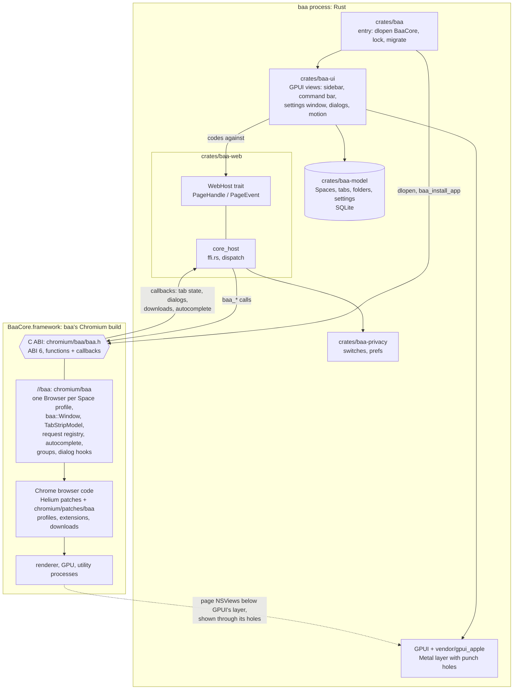

# baa

An Arc-like browser: vertical tabs, Spaces with isolated storage, a command bar, and spring-driven
motion, on baa's own Chromium build.

- Shell: Rust + [GPUI](https://github.com/zed-industries/zed/tree/main/crates/gpui) (Zed's UI framework).
- Engine: baa's own Chromium build: [Helium](https://github.com/imputnet/helium)'s patch set
  (de-Googled, GPL-3.0) plus `//baa`, a layer that lets the Rust UI drive real Chrome browsers and
  tabs (`BaaCore.framework`). Each page is a native Chromium view under GPUI's layer, so it scrolls
  and animates at the display's refresh rate, while GPUI still draws the chrome, popovers and
  command bar over it.
- Privacy: Helium patches out Google services; baa's switches cover the rest; CI checks it. No
  baa.me backend, no telemetry.
- Icons: [Lucide](https://lucide.dev) (ISC), embedded from `crates/baa-ui/assets/icons`.
- Extensions: Chrome Web Store extensions install per Space profile and run in every tab. For ad
  blocking, install uBlock Origin Lite. Open "Chrome Web Store" or "Extensions" from the command
  bar (⌘T).
- Targets: macOS (Apple silicon). Windows later, through the same `//baa`. Helium releases are
  picked up by a weekly bot PR.

`PLAN.md` is the spec (the engine is in `PLAN-chromium.md`). `CLAUDE.md` holds the rules for agents
working in this repo.

## Status

Early. Milestones 0–3 of `PLAN.md` are implemented: tabs, Spaces, per-Space storage, keymap,
command bar, de-Googling, plus Peek (links that open a tab, or shift-click, preview in a card) and
lil-baa (links from other apps open in a small window you can move into the browser), favourites
(shared by every Space) and folders. Browser basics: a Library (the archive button, or swipe right past the first Space) with
downloads kept across launches and archived tabs, a header downloads button, history
(in ⌘T, and ⌘Y), permission prompts and per-site settings, page dialogs drawn over the page,
print, view source, reader mode, Picture in Picture, translate, tab mute, Settings (⌘,), and import
of Arc's Spaces and other browsers' history. Extensions have a toolbar and popups. Settings and
Extensions are baa's own window (⌘,; `baa://settings/...` routes there), and the rest of Chrome's
pages (`baa://flags` and the like) open as tabs in baa's skin. DevTools dock beside the page. Chrome's own
prompts (HTTP auth, external-protocol links, hung or crashed pages, extension install) are drawn by
baa on the tab, page fullscreen fills the window, find shows `3/12`, tabs in a folder are a Chrome
tab group (an extension's `chrome.tabs.group` fills a folder), and the command bar ranks with
Chrome's omnibox (ABI 6). Not yet (M4): `chrome.commands` shortcuts, `chrome.action.openPopup`,
action badges, the screen-share picker. Password managers
work through their Chrome extensions; Apple's iCloud Passwords cannot (macOS only lets Chrome and
Edge start its helper). The UI follows the pen.dev mocks. Still to come from milestone 4: split view.

## Build

baa needs an engine: a directory with `baa.app` (BaaCore.framework and Chromium's helpers). There are
two ways to get one. Both need macOS, `rustup toolchain install stable` and the GitHub CLI (`gh`, logged in).
Only the second needs Xcode `27.2`.

**Rust-only work.** Download a release engine for your `chromium/` tree (about 350 MB, needs no
Xcode):

```sh
brew install zstd gh
T=$(git rev-parse HEAD:chromium)
RUN=$(gh api "repos/{owner}/{repo}/actions/artifacts?name=baa-engine-$T" -q '[.artifacts[]|select(.expired|not)][0].workflow_run.id // empty')
[ -n "$RUN" ] || { echo "no engine for tree $T; start one (below)"; exit 1; }
gh run download "$RUN" -n "baa-engine-$T" -D target/engine
zstd -dc target/engine/engine.tar.zst | tar -xf - -C target/engine
```

If no artifact exists (the check above stops), start one with
`gh workflow run chromium.yml -f mode=release` (one to two days), or use the second way.

**C++ / `//baa` work.** Download the newest `chromium-tree-xcode27.2` artifact of a successful
`chromium dev` run, unpack it at `/Users/Shared/hb`, then build incrementally:

```sh
brew install coreutils zstd gnu-tar rsync
pip3 install --user pillow requests
gh run download <run> -n chromium-tree-xcode27.2 -D /Users/Shared/dl
zstd -dc /Users/Shared/dl/tree.tar.zst | gtar -xf - -C /Users/Shared
chromium/local-build.sh
```

Then build the app and run it:

```sh
cargo bundle --run                                  # build, sign, run in the foreground
cargo bundle --release --run                        # judge smoothness only on this
cargo bundle --run --enable-logging=stderr --v=1    # Chromium's own log
```

`cargo bundle [--release] [--engine DIR] [--no-sign] [--run [args…]]` finds the engine in `--engine`,
else `$BAA_ENGINE`, else `/Users/Shared/hb/helium-macos/build/src/out/Default`, else `target/engine`.
A component engine (the dev tree) bundles in place as `<engine>/baa Dev.app`; an official engine
bundles to `target/bundle/baa.app`. Without `--run` it prints the app path. A debug build lays out
GPUI too slowly to present more than ~60 fps.

The bundle is signed with `$BAA_SIGN_IDENTITY`, else your first "Apple Development" identity, else
ad hoc. A stable identity keeps the Keychain's "Always Allow" for "baa Storage Key" and stops macOS
from asking for Documents access on every rebuild.

Development loop: `cargo check -p <crate>` and `cargo test -p <crate>`. A full `cargo build -p baa`
is slow; run it once at the end. CI runs `cargo test --release --workspace` and
`cargo clippy --release --workspace --all-targets -- -D warnings`.

The `//baa` layer (permissions, dialogs, menus, downloads, DevTools, extensions, tab and window
events) is tested by a harness, not by hand: `crates/baa-chromium` is a small gpui app that drives
BaaCore through the C ABI and logs every callback. `crates/baa-chromium/ci.sh [--engine DIR] [--only NAME]`
bundles it into an engine (same engine search as `cargo bundle`), runs every `tests/*.expect` with a
fresh profile, a local download server and the test extension, and exits non-zero with what differed.
A test is a harness script (`tests/<name>.txt`, steps documented in `src/main.rs`) plus an `.expect`
file (patterns that must or must not appear in the log, CDP probes; syntax at the top of `ci.py`).
It opens real windows and needs `node` and network. CI runs it in `ci.yml` and `chromium.yml` on the
release engine of the commit's `chromium/` tree.

Useful environment variables when running the bundle:

| Variable | Effect |
|---|---|
| `BAA_DATA_DIR=<dir>` | use a separate data directory (a clean profile for tests) |
| `BAA_ENGINE=<dir>` | engine directory for `cargo bundle` |
| `BAA_SIGN_IDENTITY=<name>` | `cargo bundle` signing identity (`-` is ad hoc) |
| `RUST_LOG=info` | shell log on stderr |

App data lives in `~/Library/Application Support/baa`: `baa.db` (session + settings),
`chromium/space-<id>/` (per-Space Chrome profile), `chromium/Crashpad/` (local crash dumps, never
uploaded), `keymap.json` (overrides `crates/baa-ui/keymaps/macos.json`). Builds from before the
move to Chromium kept profiles in `profile/space-<id>/`; the first launch moves them. Cookies do
not survive that move, so sign in to sites once more.

## Release

Tag `vX.Y.Z`, where `X.Y.Z` is the `Cargo.toml` version. `release.yml` uses the engine built from the
tagged commit's `chromium/` tree (`baa-engine-<tree>`, built by `chromium.yml` with `mode=release`;
it fails and says what to run if there is none), adds the Rust binary, signs with Chromium's signer,
runs the privacy test, notarises a DMG and publishes a GitHub Release. Signing is optional for now:
without the secrets the app is ad-hoc signed, the DMG is `baa-X.Y.Z-macos-arm64-unsigned.dmg`, nothing
is notarised, and the release notes say to open it with right-click → Open. Adding these secrets
switches to Developer ID + notarisation: `MACOS_CERT_P12_BASE64`, `MACOS_CERT_PASSWORD`,
`MACOS_SIGN_IDENTITY`, `APPLE_ID`, `APPLE_TEAM_ID`, `APPLE_APP_PASSWORD`.

## Layout

| Path | Owns |
|---|---|
| `crates/baa` | app entry, window, single-instance lock, open-URL forwarding |
| `crates/baa-ui` | GPUI views: sidebar, command bar, theme, motion, keymap actions |
| `crates/baa-web` | the `WebHost` contract and its BaaCore implementation (C ABI in `chromium/baa/baa.h`) |
| `crates/baa-model` | Spaces, tabs, settings, SQLite persistence |
| `crates/baa-privacy` | Chromium switches and prefs, the CI proxy allowlist |
| `vendor/gpui_apple` | gpui's macOS backend with the punch-hole surface |
| `chromium` | vendored Helium + helium-macos, baa's patches, `//baa`, `local-build.sh` |
| `xtask` | `cargo bundle`, sign the DMG, notarise |

## Architecture



Chromium owns the run loop (`[NSApp run]`): `crates/baa` loads `BaaCore.framework`, installs
baa's `NSApplication`, and GPUI runs inside Chrome's loop. The UI only sees the `WebHost` trait.
`core_host` turns each `PageHandle` call into a `baa_*` C call, and each engine callback into a
`PageEvent`. A Space is a Chrome profile (`space-<id>`; an incognito Space is an off-the-record
profile), so its cookies, storage and extensions are kept apart.

Every tab is a real Chrome tab in a `TabStripModel`, so extensions see normal tabs. Its page is a
native view in a container below GPUI's view. GPUI leaves a transparent hole where the page
shows and draws the sidebar, popovers, dialogs and command bar over it. Chrome's own prompts
(permissions, HTTP auth, external links, extension installs) come back through the ABI and are
drawn by GPUI.

## Keys

⌘T command bar / new tab · ⌘L address · ⌘S sidebar · ⌘W close · ⌘⇧T reopen · ⌃⇥ next tab ·
⌘1–8 tab n · ⌘9 last · ⌃⌥→/← next/prev Space · ⌘D pin · ⌘F find · ⌘⇧N incognito Space ·
⌘Y history · ⌘⇧J Library downloads · ⌘P print · ⌥⌘U view source · ⌘⇧R reload without cache · ⌥⌘R reader mode · ⌘, settings.
Everything is remappable in `keymap.json` (GPUI's keymap format). Two-finger swipe across the
sidebar or address bar switches Spaces; hold (or right-click) Back/Forward for history; double-click
the top bar to zoom the window; double-click a Space's name to rename it. Right-click the sidebar for
New Folder; right-click a tab to favourite, pin or file it; drag tabs onto a folder or the strip above
the Space name.

## Third-party notices

Chromium's and Helium's notices are in the app at `baa://credits`; the Rust crates' are in
`Contents/Resources/rust-credits.html`. GPUI is Apache-2.0.

## Licence

GPL-3.0-only (see `LICENSE`). Helium is GPL-3.0.
